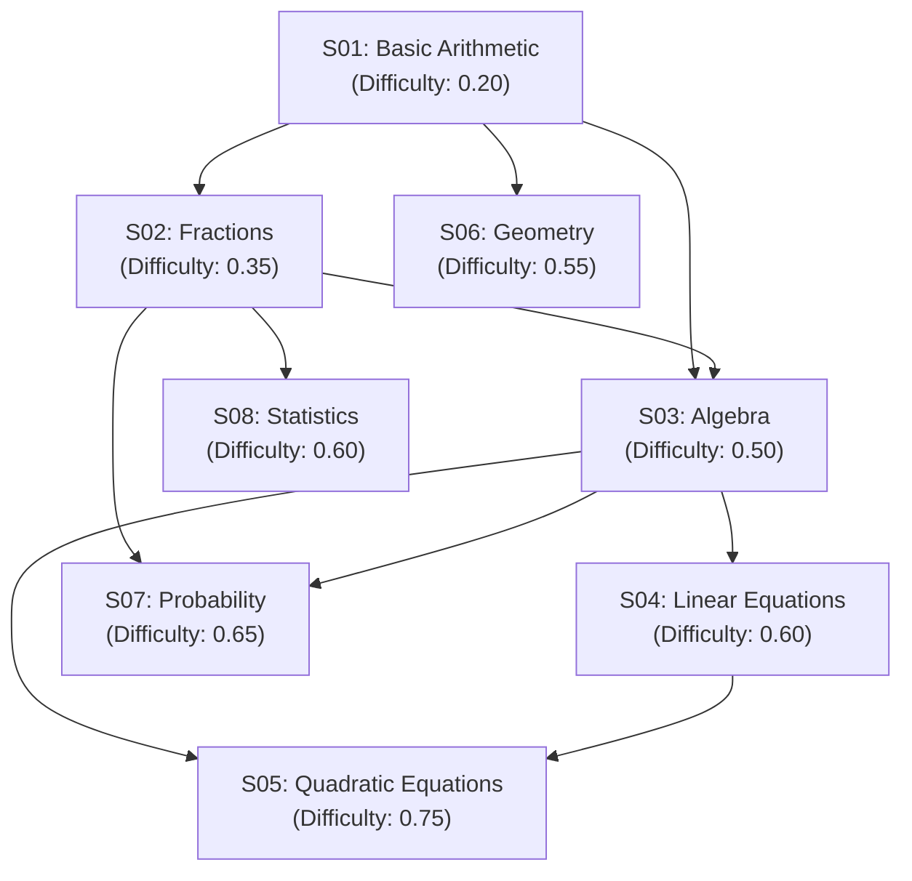

# 🎓 Student Root Cause Diagnostic & Performance Decay Identifier

[](https://www.python.org/)
[](https://fastapi.tiangolo.com/)
[](https://xgboost.readthedocs.io/)
[]()
[]()

An end-to-end Machine Learning and Diagnostic API pipeline for Intelligent Tutoring Systems (ITS) and EdTech platforms. Instead of solely evaluating whether an answer is right or wrong, this system analyzes fine-grained student interaction sequences, latency signals, prerequisite dependency graphs, and temporal learning trajectories to pinpoint the **underlying root cause** of academic struggle or performance decay.

---

## 📌 Table of Contents

- [Overview](#-overview)
- [Key Features](#-key-features)
- [Diagnostic Root Causes](#-diagnostic-root-causes)
- [Knowledge Graph Architecture](#-knowledge-graph-architecture)
- [Synthetic Data Generation](#-synthetic-data-generation)
- [Feature Engineering Pipeline](#-feature-engineering-pipeline)
- [Machine Learning Model & Training](#-machine-learning-model--training)
- [Evaluation & Benchmark Results](#-evaluation--benchmark-results)
- [FastAPI Serving & API Reference](#-fastapi-serving--api-reference)
- [Repository Structure](#-repository-structure)
- [Installation & Quickstart](#-installation--quickstart)
- [Future Roadmap](#-future-roadmap)

---

## 🌟 Overview

In digital learning environments, a student answering a question incorrectly can stem from vastly different cognitive, pedagogical, or situational factors:
- Did the learner hit an intellectual wall because their session lasted too long (**Cognitive Fatigue**)?
- Are they missing foundational concepts needed to solve this problem (**Structural Prerequisite Failure**)?
- Did they misunderstand specific terminology or phrasing despite possessing underlying aptitude (**Linguistic Misunderstanding**)?
- Or was it simply an isolated slip-up within expected variance (**Normal Performance Variation**)?

Providing adaptive learning interventions requires discriminating between these failure modes in real time. This repository implements:
1. **Prerequisite Knowledge Modeling**: A multi-tiered mathematical skill graph spanning arithmetic to quadratic equations.
2. **Behavioral Interaction Simulation**: A realistic synthetic interaction generator modeling student latent abilities, mastery gains, memory decay, and fatigue accumulation across 50,000 interactions.
3. **Leakage-Free Feature Engineering**: Rolling temporal features, response time acceleration ratios, and prerequisite failure rates computed strictly with past data.
4. **Extreme Gradient Boosting (XGBoost) Classifier**: A high-performance gradient-boosted decision tree pipeline trained with chronological splitting and balanced sample weighting.
5. **Production-Ready FastAPI Microservice**: An asynchronous REST API with Pydantic validation, health checking, and confidence scoring.

---

## 🚀 Key Features

- **Multi-Class Diagnostic Classification**: Accurately classifies four distinct failure modes with **96.04% test accuracy** and **0.9423 Macro F1**.
- **Chronological Split Validation**: Uses time-ordered splits (70% train, 15% validation, 15% test) instead of random splits to guarantee prospective validity and eliminate temporal data leakage.
- **Class-Imbalance Handling**: Dynamic balanced sample weighting ensures minority classes (e.g., fatigue and structural failure) achieve robust recall (>90%).
- **Strict Data Integrity**: All rolling accuracy and latency features use historical shifts (`shift(1)`) so the current interaction never pollutes predictor features.
- **Self-Documenting REST API**: FastAPI server with automated Swagger docs (`/docs`), strict input boundaries, and runtime artifact consistency checks.

---

## 🔍 Diagnostic Root Causes

The system identifies four primary root causes:

| Root Cause Class | Pedagogical Meaning | Dominant Behavioral Signals | Recommended System Action |
|---|---|---|---|
| **`cognitive_fatigue`** | Mental exhaustion after extended engagement or long continuous testing sessions. | High `session_length`, spike in `response_time_change`, elevated `cross_skill_error_rate`. | Recommend taking a break, pausing session, or switching to low-cognitive-load review. |
| **`structural_prerequisite_failure`** | Inability to answer correctly due to unmastered foundational skills earlier in the curriculum DAG. | High `prerequisite_failure_rate`, elevated `same_skill_error_rate`, positive `accuracy_decay`. | Route student to prerequisite remedial modules before proceeding with advanced tasks. |
| **`linguistic_misunderstanding`** | Specific misconception or misunderstanding of problem framing/phrasing without structural gaps. | Concentrated `same_skill_error_rate` while prerequisite mastery remains high. | Provide targeted hints, glossary explanations, or alternative question representations. |
| **`normal_performance_variation`** | Stochastic fluctuation, minor lapse in concentration, or expected difficulty baseline. | Low error rates across prior skills, normal response times, short session length. | Continue regular learning progression without disruption. |

---

## 🗺️ Knowledge Graph Architecture

The learning curriculum is structured as a Directed Acyclic Graph (DAG) across 8 core STEM competencies (`S01` through `S08`):



### Skill Taxonomy & Dependency Matrix

| Skill ID | Skill Name | Baseline Difficulty | Prerequisites | Downstream Dependents |
|:---:|---|:---:|:---:|:---:|
| **S01** | Basic Arithmetic | 0.20 | *None* | S02, S03, S06 |
| **S02** | Fractions | 0.35 | S01 | S03, S07, S08 |
| **S03** | Algebra | 0.50 | S01, S02 | S04, S05, S07 |
| **S04** | Linear Equations | 0.60 | S03 | S05 |
| **S05** | Quadratic Equations | 0.75 | S03, S04 | *None* |
| **S06** | Geometry | 0.55 | S01 | *None* |
| **S07** | Probability | 0.65 | S02, S03 | *None* |
| **S08** | Statistics | 0.60 | S02 | *None* |

---

## 🎲 Synthetic Data Generation

The synthetic generation script ([synthatic_data.py](file:///home/austin/algorithms/root_cause_identifier/synthatic_data.py)) creates a realistic, longitudinally consistent dataset:

### Simulation Mechanics

1. **Cohort Scale**: 500 distinct students, each completing 100 sequential interactions over a multi-month span (**50,000 interactions** total).
2. **Latent Student Ability**: Each student $\theta \sim \mathcal{N}(0, 0.8)$ initializes skill masteries $M_{s} \sim \mathcal{N}(0.60 + 0.08\theta, 0.12)$ bounded in $[0.10, 0.95]$.
3. **Question Bank**: 240 parameterized items across three difficulty tiers ($0.25, 0.50, 0.75$) perturbed by Gaussian noise.
4. **Effective Ability & Response Probability**:
   $$\text{Effective Ability } A_{\text{eff}} = M_{\text{skill}} + 0.30 \cdot M_{\text{prereq}} - 0.70 \cdot D_{\text{item}} - 0.20 \cdot \text{Fatigue}$$
   $$P(\text{Correct}) = \sigma\left(4 \cdot (A_{\text{eff}} - 0.35)\right) = \frac{1}{1 + e^{-4(A_{\text{eff}} - 0.35)}}$$
5. **Latency Dynamics**:
   $$\text{Response Time (ms)} = \max\left(1500, 4000 + 10000 \cdot D_{\text{item}} + 5000 \cdot (1 - M_{\text{skill}}) + 6000 \cdot \text{Fatigue} + \epsilon\right)$$
6. **Mastery & Fatigue Evolution**:
   - Correct answer: $M_{\text{skill}} \leftarrow M_{\text{skill}} + 0.04 \cdot (1 - M_{\text{skill}})$
   - Incorrect answer: $M_{\text{skill}} \leftarrow M_{\text{skill}} - 0.02$
   - Fatigue increments by $+0.04$ per question ($+0.07$ after 10 questions), resetting to $0$ upon session termination.

---

## 📊 Feature Engineering Pipeline

The model utilizes **21 predictors** ([feature_columns.json](file:///home/austin/algorithms/root_cause_identifier/feature_columns.json)), engineered to capture instantaneous, historical, and contextual learner state without future leakage:

| # | Feature Name | Type | Range / Unit | Description |
|:---:|---|:---:|:---:|---|
| 1 | `skill_id` | Categorical / Int | 0 – 7 | Encoded integer identifying the active skill (`S01` to `S08`). |
| 2 | `correct` | Binary | 0 or 1 | Interaction correctness outcome. |
| 3 | `elapsed_time_ms` | Float | $\ge 1500$ ms | Time spent answering the current item. |
| 4 | `question_difficulty` | Float | $[0.05, 0.95]$ | Item difficulty rating. |
| 5 | `question_attempt_number` | Integer | $\ge 1$ | Times the student has encountered this specific item. |
| 6 | `interaction_sequence` | Integer | $\ge 1$ | Cumulative sequence counter across student learning history. |
| 7 | `recent_accuracy` | Float | $[0.0, 1.0]$ | 5-item rolling average accuracy (shifted by 1). |
| 8 | `historical_accuracy` | Float | $[0.0, 1.0]$ | Expanding cumulative accuracy across all past items. |
| 9 | `accuracy_decay` | Float | $[-1.0, 1.0]$ | `historical_accuracy - recent_accuracy` (performance drop). |
| 10 | `recent_response_time` | Float | $\ge 0$ ms | 5-item rolling average response latency (shifted by 1). |
| 11 | `response_time_change` | Float | $\ge 0$ | Ratio: `recent_response_time / historical_response_time`. |
| 12 | `same_skill_error_rate` | Float | $[0.0, 1.0]$ | 5-item rolling error rate restricted to current `skill_id`. |
| 13 | `cross_skill_error_rate` | Float | $[0.0, 1.0]$ | 10-item rolling error rate across all skills. |
| 14 | `prerequisite_failure_rate` | Float | $[0.0, 1.0]$ | Deficit rate ($1 - \text{mean prerequisite mastery}$). |
| 15 | `session_length` | Integer | $\ge 1$ | Number of consecutive items answered in current session. |
| 16 | `time_since_last_interaction`| Float | $\ge 0$ seconds | Idle gap since prior interaction. |
| 17 | `test_elapsed_time` | Float | $\ge 0$ seconds | Total active seconds elapsed in current session. |
| 18 | `interaction_hour` | Integer | 0 – 23 | Time of day interaction occurred. |
| 19 | `interaction_day_of_week` | Integer | 0 – 6 | Day of week (0 = Monday, 6 = Sunday). |
| 20 | `interaction_month` | Integer | 1 – 12 | Calendar month. |
| 21 | `is_weekend` | Binary | 0 or 1 | Indicator for Saturday / Sunday activity. |

---

## 🧠 Machine Learning Model & Training

### Model Specification

- **Algorithm**: `xgboost.XGBClassifier`
- **Objective**: `multi:softprob` (multiclass probability estimation)
- **Tree Method**: `hist` (Histogram-optimized tree building for fast tabular training)
- **Hyperparameters**:
  - `n_estimators`: 500
  - `max_depth`: 6
  - `learning_rate`: 0.05
  - `subsample`: 0.85
  - `colsample_bytree`: 0.85
  - `min_child_weight`: 2
  - `reg_alpha` (L1): 0.1
  - `reg_lambda` (L2): 1.0
  - `eval_metric`: `mlogloss`

### Data Splitting Strategy

The training pipeline uses **chronological splitting** on 50,000 interactions to preserve temporal validity:
- **Training Set**: First 35,000 interactions (70%)
- **Validation Set**: Next 7,500 interactions (15%)
- **Test Set**: Final 7,500 interactions (15%)

Class weights are computed exclusively on the training split using `sklearn.utils.class_weight.compute_sample_weight('balanced', y_train)`.

---

## 📈 Evaluation & Benchmark Results

### Overall Performance

| Metric | Validation Set | Unseen Test Set |
|---|:---:|:---:|
| **Accuracy** | **94.61%** | **96.04%** |
| **Macro Precision** | 92.23% | **93.86%** |
| **Macro Recall** | 92.74% | **94.63%** |
| **Macro F1-Score** | 92.47% | **94.23%** |
| **Weighted F1-Score** | 94.65% | **96.06%** |

### Test Classification Report by Class

```
                                  precision    recall  f1-score   support

               cognitive_fatigue     0.9256    0.9533    0.9392       835
     linguistic_misunderstanding     0.9955    0.9918    0.9936      3540
    normal_performance_variation     0.9599    0.9397    0.9497      2090
structural_prerequisite_failure     0.8735    0.9005    0.8868      1035

                        accuracy                         0.9604      7500
                       macro avg     0.9386    0.9463    0.9423      7500
                    weighted avg     0.9609    0.9604    0.9606      7500
```

### Feature Importance (Gini Gain)

From [feature_importance.csv](file:///home/austin/algorithms/root_cause_identifier/feature_importance.csv):

| Rank | Feature | Importance Score | Primary Diagnostic Relevance |
|:---:|---|:---:|---|
| 1 | `same_skill_error_rate` | **0.2555** (25.5%) | Strongest indicator of concept misunderstanding / linguistic barrier |
| 2 | `session_length` | **0.1818** (18.2%) | Primary indicator of cognitive fatigue |
| 3 | `recent_accuracy` | **0.1205** (12.0%) | Signals sudden onset of learning struggle |
| 4 | `interaction_sequence` | **0.0794** (7.9%) | Historical learning progression baseline |
| 5 | `prerequisite_failure_rate` | **0.0722** (7.2%) | Direct signal for structural prerequisite deficits |
| 6 | `cross_skill_error_rate` | **0.0537** (5.4%) | Discriminates broad fatigue from skill-specific confusion |
| 7 | `test_elapsed_time` | **0.0338** (3.4%) | Active duration within testing session |
| 8 | `question_attempt_number` | **0.0320** (3.2%) | Identifies repeated stumbling on single items |
| 9 | `skill_id` | **0.0265** (2.6%) | Encodes intrinsic domain hardness |
| 10 | `response_time_change` | **0.0237** (2.4%) | Latency divergence (exhaustion slowing vs impulsive guessing) |

---

## ⚡ FastAPI Serving & API Reference

The project includes a production-grade FastAPI server ([main.py](file:///home/austin/algorithms/root_cause_identifier/main.py)).

### Starting the Server

```bash
uvicorn main:app --host 0.0.0.0 --port 8000 --reload
# or
python main.py
```

Interactive OpenAPI documentation is immediately available at:
- Swagger UI: `http://localhost:8000/docs`
- ReDoc: `http://localhost:8000/redoc`

---

### Endpoints

#### 1. Health Check: `GET /health`

**Response (`200 OK`):**
```json
{
  "status": "ok",
  "model_type": "XGBClassifier"
}
```

---

#### 2. Root Cause Inference: `POST /predict`

**Request Body (`application/json`):**
```json
{
  "skill_id": "S03",
  "correct": 0,
  "elapsed_time_ms": 11500.0,
  "question_difficulty": 0.65,
  "question_attempt_number": 1,
  "interaction_sequence": 45,
  "recent_accuracy": 0.20,
  "historical_accuracy": 0.72,
  "accuracy_decay": 0.52,
  "recent_response_time": 10500.0,
  "response_time_change": 1.45,
  "same_skill_error_rate": 0.80,
  "cross_skill_error_rate": 0.60,
  "prerequisite_failure_rate": 0.15,
  "session_length": 28,
  "time_since_last_interaction": 45.0,
  "test_elapsed_time": 2400.0,
  "interaction_hour": 21,
  "interaction_day_of_week": 3,
  "interaction_month": 4,
  "is_weekend": 0
}
```

**Response (`200 OK`):**
```json
{
  "root_cause": "cognitive_fatigue",
  "confidence": 0.9412,
  "probabilities": {
    "cognitive_fatigue": 0.9412,
    "linguistic_misunderstanding": 0.0321,
    "normal_performance_variation": 0.0182,
    "structural_prerequisite_failure": 0.0085
  }
}
```

---

### Example cURL Request

```bash
curl -X POST "http://127.0.0.1:8000/predict" \
     -H "Content-Type: application/json" \
     -d '{
       "skill_id": "S05",
       "correct": 0,
       "elapsed_time_ms": 9400.0,
       "question_difficulty": 0.75,
       "question_attempt_number": 2,
       "interaction_sequence": 30,
       "recent_accuracy": 0.20,
       "historical_accuracy": 0.65,
       "accuracy_decay": 0.45,
       "recent_response_time": 9000.0,
       "response_time_change": 1.10,
       "same_skill_error_rate": 0.80,
       "cross_skill_error_rate": 0.20,
       "prerequisite_failure_rate": 0.70,
       "session_length": 6,
       "time_since_last_interaction": 60.0,
       "test_elapsed_time": 360.0,
       "interaction_hour": 14,
       "interaction_day_of_week": 2,
       "interaction_month": 3,
       "is_weekend": 0
     }'
```

### Python Client Example

```python
import requests

payload = {
    "skill_id": "S02",
    "correct": 0,
    "elapsed_time_ms": 8200.0,
    "question_difficulty": 0.40,
    "question_attempt_number": 1,
    "interaction_sequence": 15,
    "recent_accuracy": 0.40,
    "historical_accuracy": 0.60,
    "accuracy_decay": 0.20,
    "recent_response_time": 8000.0,
    "response_time_change": 1.05,
    "same_skill_error_rate": 0.60,
    "cross_skill_error_rate": 0.30,
    "prerequisite_failure_rate": 0.65,
    "session_length": 8,
    "time_since_last_interaction": 40.0,
    "test_elapsed_time": 320.0,
    "interaction_hour": 10,
    "interaction_day_of_week": 1,
    "interaction_month": 2,
    "is_weekend": 0,
}

response = requests.post("http://127.0.0.1:8000/predict", json=payload)
data = response.json()

print(f"Predicted Root Cause : {data['root_cause']}")
print(f"Prediction Confidence: {data['confidence']:.2%}")
print("Probability Breakdown:")
for cause, prob in data["probabilities"].items():
    print(f"  • {cause:32s}: {prob:.4f}")
```

---

## 📁 Repository Structure

```text
root_cause_identifier/
├── evaluation_results.json                   # Comprehensive validation/test evaluation metrics & report
├── feature_columns.json                      # Preserved feature ordering expected by XGBoost
├── feature_importance.csv                    # Ranked feature importances calculated via Gini gain
├── main.py                                   # FastAPI inference microservice with Pydantic schemas
├── requirements.txt                          # Python dependencies (FastAPI, XGBoost, pandas, etc.)
├── root_cause_decay_diagnostic_training.ipynb# End-to-end model training & evaluation notebook
├── root_cause_decay_synthetic.csv            # Generated synthetic dataset (50k student interactions)
├── root_cause_model_metadata.json            # Model configuration, skill encoding mappings, & stats
├── root_cause_xgboost_model.pkl              # Serialized XGBoost model binary (joblib format)
├── synthatic_data.py                         # Synthetic dataset generation engine with knowledge DAG
├── synthatic_dataset.py                      # Synthetic dataset generator script
└── README.md                                 # Complete project documentation
```

---

## 🛠️ Installation & Quickstart

### 1. Prerequisites

- Python 3.10 or higher
- `pip` or virtual environment manager (`venv` / `conda`)

### 2. Environment Setup

```bash
# Navigate to the project directory
cd /home/austin/algorithms/root_cause_identifier

# Create and activate a virtual environment
python3 -m venv .venv
source .venv/bin/activate       # On Linux/macOS
# .venv\Scripts\activate        # On Windows

# Install dependencies
pip install -r requirements.txt
```

### 3. Generate New Synthetic Interactions (Optional)

If you wish to re-simulate student learning data with custom student counts or adjusted learning rates:

```bash
python synthatic_data.py
```

This will generate a fresh `root_cause_decay_synthetic.csv`.

### 4. Train the Model (Optional)

Open and execute the training notebook in Jupyter or VS Code:

```bash
pip install jupyterlab matplotlib seaborn scikit-learn
jupyter lab root_cause_decay_diagnostic_training.ipynb
```

The notebook will automatically export:
- Updated model binary: `root_cause_xgboost_model.pkl`
- Feature columns: `feature_columns.json`
- Model metadata: `root_cause_model_metadata.json`

### 5. Launch the REST API

```bash
uvicorn main:app --reload --host 127.0.0.1 --port 8000
```

Verify service availability:
```bash
curl http://127.0.0.1:8000/health
```

---

## 🔮 Future Roadmap

- [ ] **SHAP/LIME Explainability Layer**: Provide real-time watermarked feature attribution explanations directly inside the API response for teachers and adaptive engines.
- [ ] **Deep Knowledge Tracing (DKT) Integration**: Combine transformer-based sequence models with tree-based diagnostics for hybrid sequence-tabular modeling.
- [ ] **Dynamic Skill Taxonomy**: Extend the prerequisite engine to support runtime ingestion of arbitrary Bloom's taxonomy knowledge maps.
- [ ] **Batch Prediction Endpoint**: Add `/predict/batch` endpoint for asynchronous bulk assessment processing.
- [ ] **Docker Containerization**: Provide a multi-stage Dockerfile and docker-compose recipe for turnkey Kubernetes deployment.

---

## 📄 License & Attribution

This project is developed for educational data mining, intelligent tutoring systems, and algorithmic learning analytics research. Free to use and adapt for academic and production learning platforms.
